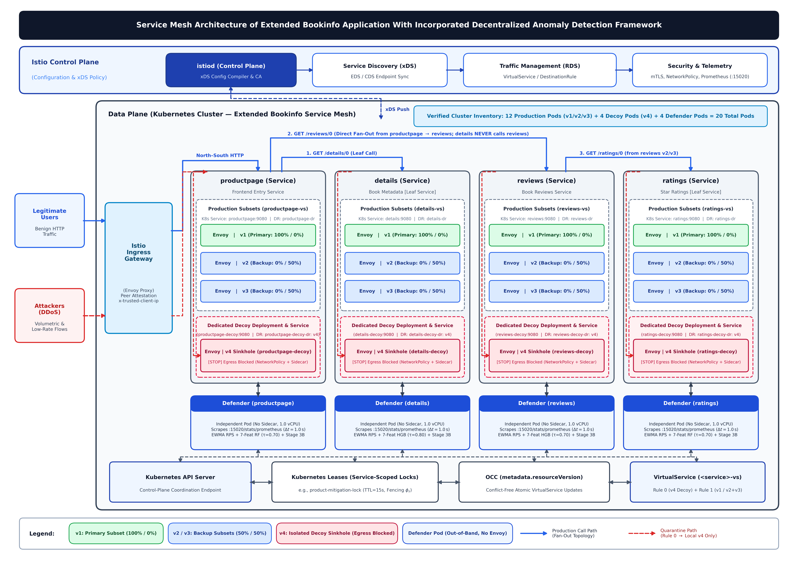
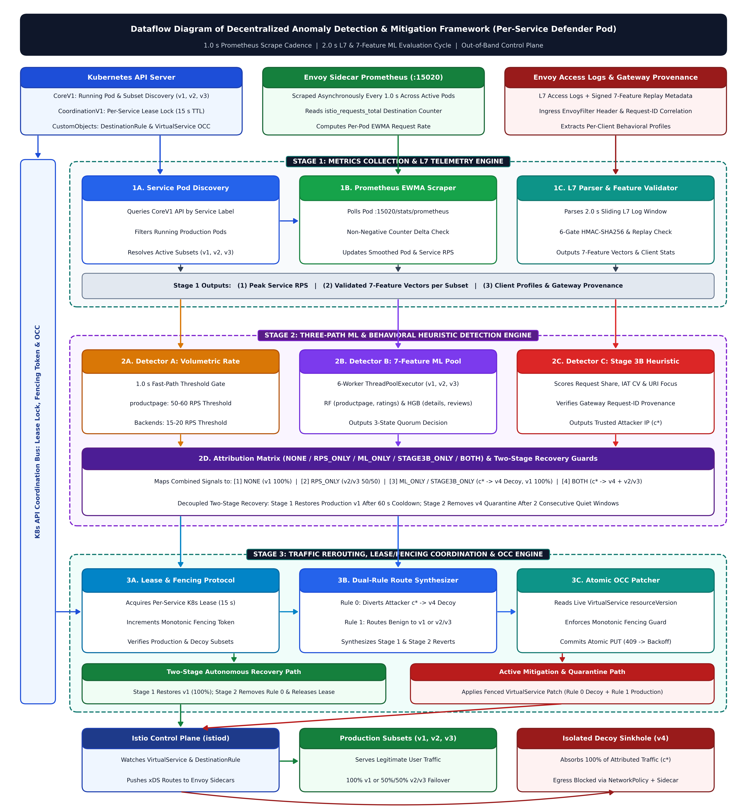
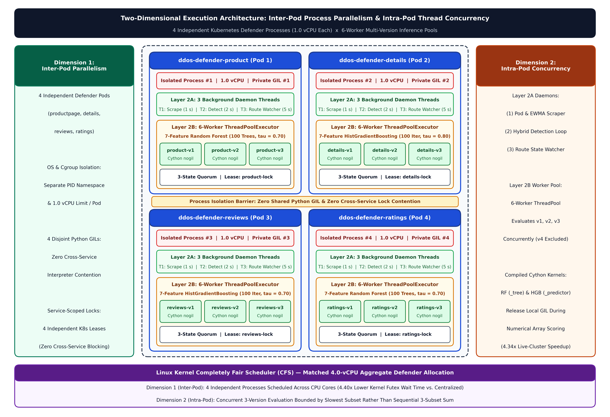

# DDoS Detector Project: Decentralized Autonomic ML Defense for Kubernetes & Istio Service Mesh

[](https://www.python.org/)
[](https://kubernetes.io/)
[](https://istio.io/)
[](https://scikit-learn.org/)
[](LICENSE)

This repository provides the complete source code, Kubernetes and Istio deployment manifests, frozen 7-feature machine learning model bundles (`RandomForest` and `HistGradientBoosting`), automated benchmark harnesses (Scenarios 1–5), and verification artifacts for our **decentralized, autonomic DDoS detection and conflict-free mitigation framework** in Kubernetes and Istio service mesh environments.

---

## Table of Contents
1. [Architecture Overview](#1-architecture-overview)
2. [Key Experimental Highlights](#2-key-experimental-highlights)
3. [Repository Structure](#3-repository-structure)
4. [Service-Specialized 7-Feature ML Models](#4-service-specialized-7-feature-ml-models)
5. [Prerequisites & Cluster Setup](#5-prerequisites--cluster-setup)
6. [Step-by-Step Reproduction Guide (Scenarios 1–5)](#6-step-by-step-reproduction-guide-scenarios-15)
7. [Full Raw Experimental Dataset (~22 GB Cloud Archive)](#7-full-raw-experimental-dataset-22-gb-cloud-archive)

---

## 1. Architecture Overview



Rather than relying on a single centralized controller that serializes telemetry scraping, machine learning inference, and routing updates across all microservices inside one shared Python interpreter (`GIL`), this framework implements a **Two-Dimensional Execution Architecture**:

1. **Dimension 1 — Cluster-Level (Inter-Pod) Process Parallelism:**
   * Deploys four independent Kubernetes defender pods (`ddos-defender-product`, `ddos-defender-details`, `ddos-defender-reviews`, and `ddos-defender-ratings`), each running in an isolated Linux container process (`1000m` CPU limit each; `4000m` aggregate) with its own independent Python interpreter and dedicated **Global Interpreter Lock (`GIL`)** ($\text{GIL}_1 \perp \text{GIL}_2 \perp \text{GIL}_3 \perp \text{GIL}_4$).
   * Eliminates cross-service OS `futex` thread-wait contention ($4.40\times$ reduction in cumulative kernel `futex` wait time) and contains controller crash blast radius to $25\%$ ($1/4$ services) instead of $100\%$.
2. **Dimension 2 — Pod-Level (Intra-Pod) Thread-Pool Concurrency:**
   * Within each defender pod, three asynchronous daemon threads (`discover_and_scrape`, `detection_loop`, and `vs_reader_loop`) cooperate with a persistent 6-worker `ThreadPoolExecutor` (`ml_executor`) that evaluates active production subsets ($v_1, v_2, v_3$) concurrently using Cython `nogil` tree/histogram kernels.
3. **Three-Path Attribution & Selective Decoy Quarantine ($v_4$):**
   * Fuses (i) Envoy Prometheus EWMA request-rate telemetry (`:15020/stats/prometheus`), (ii) service-specialized 7-feature ML classification (`HMAC-SHA256` authenticated flow records), and (iii) Stage 3B live behavioral client attribution with 8-point `istio-ingressgateway` provenance verification.
   * Attributed malicious clients are selectively diverted via an index-0 Istio `VirtualService` match rule (`quarantine-malicious`) to an isolated, egress-blocked decoy sinkhole subset ($v_4$), while legitimate traffic either remains on primary subset $v_1$ (`ML_ONLY` / `STAGE3B_ONLY`) or load-balances across warm backups $v_2/v_3$ (`BOTH` / `RPS_ONLY`).
4. **Conflict-Free Distributed Control Plane (Kubernetes `Lease` + Fencing Token + OCC):**
   * Every routing mutation and two-stage autonomous recovery transition is serialized per service via a dedicated Kubernetes `coordination.k8s.io/v1` `Lease` lock (`<service>-mitigation-lock`, $T_{\text{lease}}=15\text{ s}$), a strictly monotonic fencing token ($\phi_s$), and `metadata.resourceVersion` Optimistic Concurrency Control (OCC).





---

## 2. Key Experimental Highlights

| Scenario | Evaluation Objective | Key Measured Result (Decentralized vs. Centralized Baseline) |
| :--- | :--- | :--- |
| **Scenario 1** | Single-service targeted quarantine (`productpage`) | **$10/10$ `PASS`** in both modes; **$30.5\%$ lower attack-to-mitigation latency** ($4.78\text{ s}$ vs. $6.88\text{ s}$) and $0\%$ benign error rate |
| **Scenario 2** | Two-dimensional concurrency & kernel `futex` profiling | **$+36.5\%$ throughput at $60\text{ RPS}$** and **$+158.1\%$ at $90\text{ RPS}$**; **$98.8\%$ lower inference latency** ($13.21\text{ ms}$ vs. $1,103.37\text{ ms}$); **$4.40\times$ lower kernel `futex` wait time** |
| **Scenario 3** | Controller crash fault-blast-radius containment | **$25\%$ blast radius** ($75\%$ defense retained; $30/30$ surviving service-trials quarantined vs. $100\%$ centralized protection loss) and **$69.8\%$ lower benign p95 latency** |
| **Scenario 4** | Heterogeneous 7-feature ML generalization & scaling | **$99.79\%\text{--}99.96\%$ strict out-of-fold accuracy**; **$99.70\%\text{--}99.97\%$ unseen Friday LOIC recall** at $0.12\%\text{--}0.19\%$ benign FPR; **$246.39\text{ RPS}$** 4-pod throughput |
| **Scenario 5** | Synchronized 4-service $160\text{ RPS}$ attack & 2-stage recovery | **$20/20$ service lifecycles completed**; **$56/56$ first-attempt OCC commits** ($0$ conflicts); **$99.98\%$ legitimate HTTP continuity** ($12,304/12,306$) |

---

## 3. Repository Structure

```text
├── README.md                          # Complete reproduction guide
├── LICENSE                            # MIT License
├── requirements.txt                   # Python dependencies
├── .gitignore                         # Git exclusion rules
├── figures/                           # Architecture and dataflow diagrams
├── src/
│   ├── defender/
│   │   ├── defender_agent.py          # Production defender agent (with HMAC-SHA256 & Lease/OCC)
│   │   ├── defender_agent_cic_v5_3.py # Baseline v5.3 defender agent
│   │   ├── test_hmac_security.py      # Unit verification for HMAC-SHA256 replay authentication
│   │   └── Dockerfile                 # Container build definition for boktiar/ddos-defender
│   └── training/
│       ├── train_approved_four_models.py          # CIC-IDS2017/DistriNet 7-feature training script
│       ├── stage4_final_untouched_evaluation.py   # Unseen Monday/Friday & LOIC generalization test
│       └── reconcile_scenario4_statistics.py      # Out-of-fold & post-refit verification script
├── manifests/
│   ├── defenders/
│   │   ├── decentralized/             # 4 service-dedicated defender Deployments & Services
│   │   └── centralized/               # Single centralized baseline Deployment (4000m CPU)
│   ├── decoys/                        # v4 decoy Deployments, Services, DestinationRules & NetworkPolicies
│   └── routing_and_rbac/              # ServiceAccount, ClusterRole (Leases/VirtualServices), VirtualServices
├── models/
│   ├── model_registry_cic.json        # Service-to-model registry mapping
│   ├── approved_four_models_manifest.json
│   ├── productpage/                   # Random Forest (100 trees, depth 15, tau=0.70, 7 features)
│   ├── details/                       # HistGradientBoosting (100 iter, tau=0.80, 7 features)
│   ├── reviews/                       # HistGradientBoosting (100 iter, tau=0.70, 7 features)
│   └── ratings/                       # Random Forest (100 trees, depth 15, tau=0.70, 7 features)
├── evaluation/
│   ├── scenario1/                     # Single-service quarantine latency & reliability (10 trials)
│   ├── scenario2/                     # Multi-service concurrency, throughput & kernel futex profiling
│   ├── scenario3/                     # Fault blast-radius isolation under induced pod crashes
│   ├── scenario4/                     # ML model out-of-fold accuracy, unseen LOIC recall & runtime scaling
│   └── scenario5/                     # Synchronized 4-service 160 RPS attack & 2-stage recovery
└── data/
    ├── Concurrency/                   # Process-level parallelism & kernel futex evidence package
    ├── FPR/                           # Strict out-of-fold accuracy & unseen benign FPR evidence
    ├── Scenarios/                     # Complete Scenario 1-5 benchmark summaries, manifests & zip packages
    └── DATA_ARCHIVE.md                # Guide & OneDrive access link for CICIDS2017_improved.zip & full raw archive
```

---

## 4. Service-Specialized 7-Feature ML Models

Each microservice uses a tailored classifier trained on the corrected **CIC-IDS2017 / DistriNet** HTTP corpus (`Wednesday` grouped `Flow ID` split: $34,682$ training flows and $8,484$ disjoint held-out validation flows) and tested without retraining on unseen `Monday`/`Friday` benign flows ($67,886$) and unseen `Friday` `LOIC` HTTP flood flows ($20,000$):

| Microservice | Classifier | Threshold ($\tau_s$) | 7 Selected CIC-IDS2017/DistriNet Flow Features ($F_s$) | Strict Out-of-Fold Accuracy | Unseen Friday LOIC Recall |
| :--- | :--- | :---: | :--- | :---: | :---: |
| **`productpage`** | Random Forest (`RF`) | `0.70` | `Flow Bytes/s`, `Total Length of Bwd Packets`, `Flow IAT Std`, `Flow IAT Max`, `Fwd IAT Total`, `Fwd IAT Mean`, `Max Packet Length` | `99.79%` | `99.97%` |
| **`details`** | HistGradientBoosting (`HGB`) | `0.80` | `Flow Duration`, `Total Fwd Packets`, `Total Backward Packets`, `Total Length of Bwd Packets`, `Bwd Packet Length Max`, `Bwd Packet Length Mean`, `Flow IAT Mean` | `99.96%` | `99.70%` |
| **`reviews`** | HistGradientBoosting (`HGB`) | `0.70` | `Flow Duration`, `Total Length of Fwd Packets`, `Fwd Packet Length Max`, `Bwd Packet Length Mean`, `Flow IAT Mean`, `Fwd IAT Std`, `Active Mean` | `99.95%` | `99.95%` |
| **`ratings`** | Random Forest (`RF`) | `0.70` | `Flow Duration`, `Bwd Packet Length Max`, `Bwd Packet Length Min`, `Flow IAT Mean`, `Flow IAT Min`, `Fwd IAT Min`, `SYN Flag Count` | `99.95%` | `99.90%` |

---

## 5. Prerequisites & Cluster Setup

### Hardware & Software Requirements
* **OS:** Ubuntu 22.04 LTS (or Linux VM / WSL2)
* **CPU / RAM:** Minimum 8 vCPUs, 16 GB RAM (4 vCPUs / 8 GiB allocated to defender pods)
* **Kubernetes:** Minikube v1.32+ / Kubernetes v1.28+
* **Service Mesh:** Istio v1.20+ (deployed with default profile and Envoy sidecar injection enabled on `default` namespace)
* **Python:** Python 3.10+

### Step 1: Install Python Dependencies
```bash
pip install -r requirements.txt
```

### Step 2: Start Minikube & Istio and Deploy Extended Bookinfo + Decoys
```bash
# 1. Start Minikube cluster with sufficient resources
minikube start --cpus=8 --memory=16384 --driver=docker

# 2. Install Istio and enable automatic Envoy sidecar injection
istioctl install --set profile=default -y
kubectl label namespace default istio-injection=enabled --overwrite

# 3. Apply RBAC roles, PriorityClass, and benchmark authentication secret
kubectl apply -f manifests/routing_and_rbac/priority.yaml
kubectl apply -f manifests/routing_and_rbac/rbac.yaml
kubectl apply -f manifests/routing_and_rbac/secret_bench_auth.yaml

# 4. Deploy Bookinfo production subsets (v1, v2, v3), v4 decoys, and VirtualServices
kubectl apply -f manifests/routing_and_rbac/details-ratings-v2.yaml
kubectl apply -f manifests/decoys/
kubectl apply -f manifests/routing_and_rbac/stage2-virtualservice.yaml
kubectl apply -f manifests/routing_and_rbac/client_surge_pods.yaml
```

### Step 3: Build & Deploy the Defender Pods
```bash
# Build the defender image inside Minikube's Docker daemon
eval $(minikube docker-env)
docker build -t boktiar/ddos-defender:cic-v5.4-hmac -f src/defender/Dockerfile .

# Option A: Deploy Decentralized Defenders (4 independent pods, 1000m CPU each)
kubectl apply -f manifests/defenders/decentralized/

# Option B: Deploy Centralized Baseline Controller (1 pod, 4000m CPU)
# (Ensure decentralized defenders are scaled down before running centralized baseline tests)
kubectl apply -f manifests/defenders/centralized/deployment_central_active.yaml
kubectl apply -f manifests/defenders/centralized/service_central.yaml
```

---

## 6. Step-by-Step Reproduction Guide (Scenarios 1–5)

### Offline Model Training & Verification (Optional — Pre-trained bundles are already in `models/`)
```bash
# Train all 4 service-specialized 7-feature models from the corrected CIC-IDS2017/DistriNet corpus
python src/training/train_approved_four_models.py

# Verify strict out-of-fold metrics, duplicate-removed sensitivity, and unseen Friday LOIC recall
python src/training/reconcile_scenario4_statistics.py
```

### Scenario 1: Single-Service Targeted Quarantine (`productpage`, 10 Trials per Mode)
```bash
# Run 10 decentralized trials
python evaluation/scenario1/run_scenario1_benchmark_10_trials.py

# Run 10 centralized baseline trials
python evaluation/scenario1/run_scenario1_centralized_10_trials.py

# Reconcile logs and generate Scenario 1 summary statistics
python evaluation/scenario1/reconcile_and_summarize_scenario1.py
```

### Scenario 2: Two-Dimensional Concurrency, Throughput & Linux Kernel `futex` Profiling
```bash
# Approach 1: Concurrent inference throughput & latency under 60 RPS and 90 RPS offered loads
python evaluation/scenario2/run_scenario2_approach1_pilot.py

# Approach 2: Live 4-service concurrent detection cycles & GIL/futex profiling
python evaluation/scenario2/run_scenario2_pilot_reconciled.py
python evaluation/scenario2/launch_tcon_gil_eval.py
```

### Scenario 3: Fault Blast-Radius Isolation Under Induced Controller Crash
```bash
# Execute 10-trial fault-injection benchmark (Decentralized 25% blast radius vs. Centralized 100% loss)
python evaluation/scenario3/run_scenario3_full_benchmark.py

# Reconcile Scenario 3 quarantine retention and benign p95 latency
python evaluation/scenario3/reconcile_scenario3_statistics.py
```

### Scenario 4: Heterogeneous 7-Feature Classifier Generalization & Container Throughput
```bash
# Execute live in-pod model latency and 1-to-4 pod throughput scaling benchmark
python evaluation/scenario4/run_scenario4_full_benchmark.py
python evaluation/scenario4/reconcile_scenario4_statistics.py
```

### Scenario 5: End-to-End 4-Service Concurrent Mitigation (`160 RPS`) & Two-Stage Autonomous Recovery
```bash
# Verify HMAC-SHA256 replay authentication security gates
python src/defender/test_hmac_security.py

# Execute 5 synchronized 4-service repetitions (20 service lifecycles, Lease/OCC audit, Stage 1 & Stage 2 recovery)
python evaluation/scenario5/run_scenario5_repetition_series.py

# Aggregate Scenario 5 lifecycle, OCC commit, and benign HTTP continuity statistics
python evaluation/scenario5/aggregate_scenario5_statistics.py
```

---

## 7. Experimental Evidence (`data/`) & OneDrive Cloud Archive

All primary experimental evidence packages, reconciled summary JSONs, SHA-256 manifests, and markdown audit reports are included directly in this repository under [`data/`](data/):
* **[`data/Concurrency/`](data/Concurrency/):** Multi-process execution overlap, Linux `strace` kernel `futex` profiling, and GIL ablation evidence (`PROCESS_LEVEL_PARALLEL_EVIDENCE_PACKAGE.zip`).
* **[`data/FPR/`](data/FPR/):** Strict out-of-fold accuracy, duplicate-removed sensitivity, and unseen Monday/Friday benign false-positive rate validation.
* **[`data/Scenarios/`](data/Scenarios/):** Complete benchmark summary JSONs, reports, and raw evidence `.zip` packages for **Scenario 1** through **Scenario 5**.

Because GitHub enforces a 100 MB per-file limit, the upstream corrected dataset (**`CICIDS2017_improved.zip`**, `~335.5 MB`) and the uncondensed historical multi-cycle raw archive (**`Backup raw experimental data for journal`**, `~1.73 GB`) are hosted on **OneDrive**. See [`data/DATA_ARCHIVE.md`](data/DATA_ARCHIVE.md) for details and access instructions.
